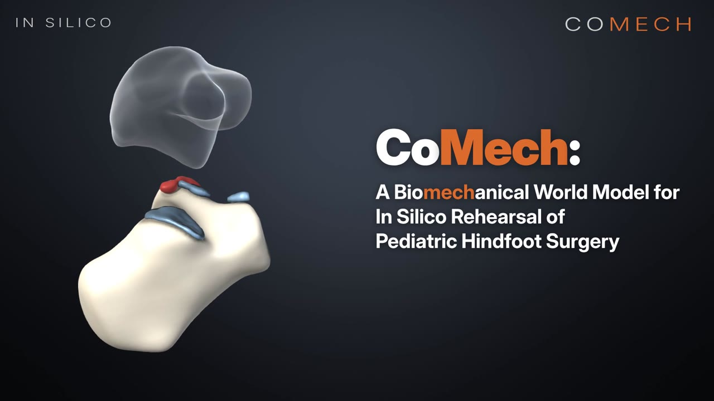

# Video demonstration

`CoMech_demo.mp4` (99 s, 1920 × 1080, H.264 with AAC audio) is Supplementary Video 1 of the paper. It follows the virtual child of Fig. 7a (atlas foot, type I coalition) through the whole pipeline.

| Time | Scene |
|---|---|
| 0:00 | The foot of the virtual child, the hindfoot and its middle-facet bridge; title |
| 0:11 | Surgical actions applied by the FE data engine: complete resection (39% middle-facet defect), calcaneal osteotomy (shown with a 10-mm medial shift), interposition, subtalar fusion and load, with their FE stress |
| 0:23 | Twelve virtual feet of the virtual cohort: 2,016 FE solutions, 252 virtual feet × 8 actions |
| 0:30 | Inside one FE solution: tissue labels, von Mises stress and displacement on sagittal sections, and a three-dimensional view (1.0-mm solution of the child after complete resection) |
| 0:37 | The architecture of CoMech (Figs. 1 and 4, shown block by block) |
| 0:57 | Full-field prediction: FE and CoMech stress for the held-out foot of Fig. 5a |
| 1:03 | Rehearsal in latent space: latent states of the 42 rehearsed adjuncts |
| 1:09 | Rehearse, then verify by FE: resection alone and the rehearsed 3-mm medializing osteotomy, CoMech and FE, with the change of five effect descriptors |
| 1:17 | The 50% rule against FE-verified envelopes in the virtual cohort (Fig. 6c) |
| 1:24 | CT-informed twins of 39 real feet: CT reconstruction, coronal reformats and point twin of P05-R (Fig. 8; preliminary reading, pending clinician adjudication, no outcomes) |
| 1:32 | Closing card with the scope of the study |

All three-dimensional scenes are rendered from the geometry and result files of the data engine; the CT images are those of Fig. 8. No generative image model was used, and the background music was synthesized programmatically. All results are in silico; clinical validation remains necessary.
